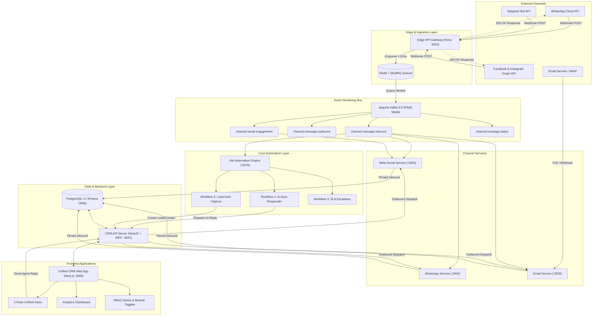
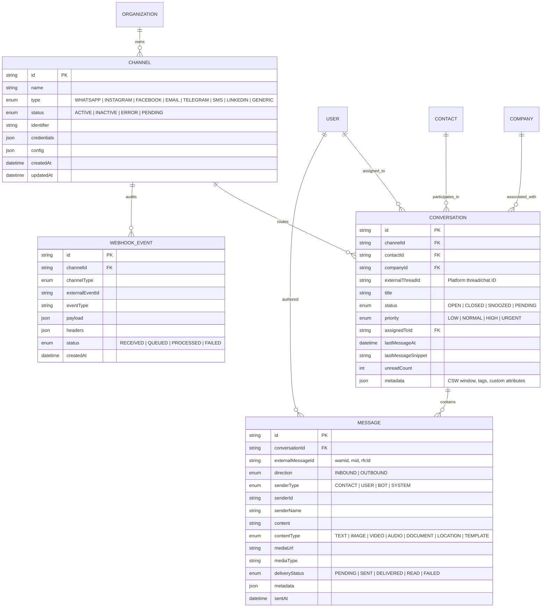

# 🏛️ CAG-Agents Omnichannel CRM — System Architecture

> **Project:** CAG-Agents Omnichannel AI CRM Platform  
> **Authors:** Chhayansh (Lead), Ashish, Garvit  
> **Target Release:** Deliverable 1 (November 2026)

---

## 1. System Overview

The **CAG-Agents Omnichannel CRM** is an event-driven, microservices-based customer relationship management platform designed to unify customer interactions across disparate communication channels into a single, cohesive timeline.

Supported channels include:
- **WhatsApp** (WhatsApp Cloud API)
- **Facebook Messenger & Instagram Direct** (Meta Graph API)
- **Social Media Content & Comments** (Facebook Page Feed, Instagram Media)
- **Email Management** (IMAP / Gmail & SMTP)
- **Telegram Bot API**

---

## 2. High-Level Architecture Diagram



---

## 3. End-to-End Inbound Data Pipeline

### 3.1. Edge API Gateway (`services/gateway/`)
- **Technology**: Hono on Bun runtime.
- **Role**: Immediate webhook ingestion decoupler.
- **SLA**: Returns `200 OK` in `< 50ms` (well within Meta's mandatory 15-second timeout window).
- **Security**: Validates incoming request signatures:
  - Meta: HMAC-SHA256 (`x-hub-signature-256`)
  - Telegram: Secret token (`x-telegram-bot-api-secret-token`)
- **Buffering**: Pushes raw payloads into a Redis job queue using BullMQ.

### 3.2. Event Bus & Kafka Topics
A BullMQ worker extracts events from Redis, normalizes headers, and publishes to Kafka event topics:
- `channel.message.inbound`: New incoming customer text, image, audio, or document.
- `channel.message.outbound`: Messages sent by CRM human agents or AI automations.
- `channel.social.engagement`: Public post comments, story mentions, postbacks.
- `channel.message.status`: Delivery receipts (`sent`, `delivered`, `read`, `failed`).

### 3.3. Channel Microservices
Independent microservices consume from the pipeline and maintain bi-directional communication:
1. **Meta Social Service (`services/meta-social`)**:
   - Handles Facebook Page Messenger and Instagram Direct messages.
   - Listens to Page Feed post comments and Instagram media comments.
   - Outbound messaging via Meta Graph API (`/me/messages` and `/{comment-id}/comments`).
2. **WhatsApp Service (`services/whatsapp`)**:
   - Cloud API webhook listener for WhatsApp Business accounts.
   - Interactive button, list message, and template message dispatcher.
   - 24-hour Customer Service Window (CSW) tracking.
3. **Email Management Service (`services/email`)**:
   - Inbound email parsing with RFC 822 header extraction (`Message-ID`, `In-Reply-To`, `References`).
   - Outbound SMTP delivery maintaining threaded conversation continuity.

---

## 4. Database Schema Design (Prisma PostgreSQL)

The unified schema bridges disparate channel formats into four core models:



---

## 5. Core Automation Layer (n8n Engine)

The system embeds **n8n** (self-hosted in Docker on port `5678`) to provide visual workflow automation:

| Workflow | File | Description |
|---|---|---|
| **Omnichannel AI Auto-Responder** | `services/n8n/workflows/omnichannel_ai_auto_reply.json` | Analyzes inbound message intent (Sales vs Support). Automatically drafts and dispatches high-confidence AI replies via channel APIs. |
| **Lead Auto-Capture** | `services/n8n/workflows/lead_capture_and_enrichment.json` | Detects new senders across social channels/email, extracts profile names, and creates CRM `Contact` records with attribution. |
| **SLA Escalation Alert** | `services/n8n/workflows/sla_escalation_alert.json` | Runs every 5 minutes. Scans for unread messages pending >15 minutes, automatically escalates priority to `URGENT`, and alerts the team. |

---

## 6. Planned Architecture Specifications (Documented)

### 6.1. Token Bucket Rate Limiter Architecture
To prevent API quota exhaustion and account bans across third-party platforms (e.g. Instagram's 200 requests/user/hour, WhatsApp messaging tiers), the rate limiter is designed using the **Token Bucket Algorithm** backed by Redis:

```
[Request] ---> [Check Redis Bucket Key: `ratelimit:{channel}:{account_id}`]
                    |
          +---------+---------+
          |                   |
    [Tokens Available]   [Tokens Empty]
          |                   |
    [Decrement 1]        [Queue in BullMQ delayed job]
          |                   |
    [Execute Call]       [Wait for refillInterval]
```

- **Capacity ($B$)**: Maximum burst capacity allowed by the platform.
- **Refill Rate ($r$)**: Tokens added per unit of time (e.g. 200 tokens / 3600 seconds).
- **Atomic Execution**: Executed via a Redis Lua script to prevent race conditions across distributed microservices.

### 6.2. Meta Comment-to-DM CSW Compliance Architecture
Under Meta policy, private replies to public Facebook or Instagram post comments can be sent outside the standard 24-hour messaging window only once, provided the request includes the `comment_id`:

```
[User Comments on Post] 
       │
       ▼ Webhook
[Meta Social Service: `processFacebookFeedComment`]
       │
       ▼ Saves Message with `metadata.commentId`
[CRM Inbox UI: Agent clicks "Send Private Reply"]
       │
       ▼ API Request with `comment_id` passthrough
[Meta Graph API POST `/me/messages`]
   Payload: {
     "recipient": { "comment_id": "<COMMENT_ID>" },
     "message": { "text": "<REPLY_TEXT>" }
   }
       │
       ▼ Creates Private 1-on-1 Messenger Thread
[CSW Window opens for 24 hours once user replies in DM]
```

---

## 7. Local Infrastructure & Docker Compose Stack

The local development stack runs via `docker-compose.yml`:

| Service | Port | Image | Purpose |
|---|---|---|---|
| **PostgreSQL** | `5432` | `postgres:17-alpine` | Primary relational database |
| **Redis** | `6379` | `redis:7-alpine` | In-memory job queue & cache |
| **Kafka** | `9092` | `bitnami/kafka:3.9` | Event streaming broker (KRaft) |
| **Kafka UI** | `8080` | `provectuslabs/kafka-ui:latest` | Web dashboard for Kafka topics |
| **n8n** | `5678` | `docker.n8n.io/n8nio/n8n:latest` | Automation workflow engine |
| **Gateway** | `3002` | Bun / Hono | Edge webhook receiver |
| **Meta Service** | `3003` | Bun / Hono | Facebook & Instagram worker |
| **CRM Backend** | `3001` | NestJS + tRPC | Core CRM business API |
| **CRM Web App** | `3000` | Next.js App Router | Unified Inbox & Dashboards |
